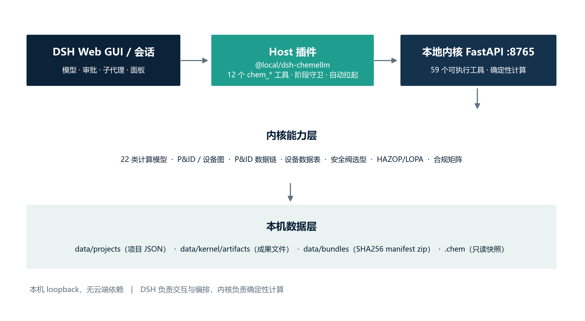
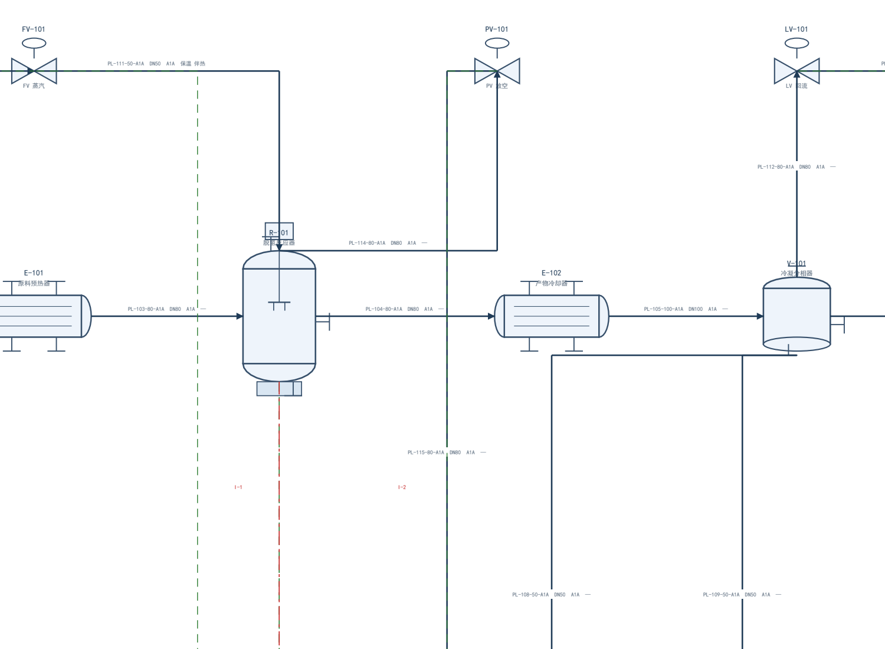

# ChemELLM · 本地化工工程工作台

把化工设计的**资料、要求、计划、依据、计算、图纸、校核与打包**放进一个 AI 工作台，全程在本机跑完，不依赖云端。

它由两部分组成：**DSH 插件**负责对话、编排、审批与界面，**本地 Python 内核**（FastAPI，`127.0.0.1:8765`）负责确定性计算、文档与图纸生成、证据检索。两者通过 loopback 通信，数据全部落在本机磁盘。



> 当前版本 **v0.1（本机可用）**：单用户、单机、loopback；已有两个从空项目走通的验收案例。能力边界见文末，不写未实现的规划。

---

## 它解决什么问题

化工设计通常是这样推进的：任务书在 PDF 里，要求靠人工拆；物性查手册，衡算写 Excel，精馏靠手算或商业软件；PFD 用 CAD 画；最后交一摞文件。三个老问题反复出现：

- **数字说不清来源**：报告里的 120 kmol/h 是哪一版假设、什么工况下的结果？
- **改一处，全线返工**：转化率一改，衡算、塔、换热器、经济全部要重算，图纸和表格还得手工同步。
- **交付物不一致**：报告、图纸、数据表各说各话，没人能一键验证。

ChemELLM 把这套流程做成一条**可追溯的流水线**：

- 每个数值必须写明**单位、条件、来源**（假设 / 设计选择 / 文档 / 计算四类）；
- 每条要求逐条编码登记，要求 → 成果的映射缺一个，校核就拦下；
- 改依据或改计算后，受影响的成果重新生成，旧审核自动失效；
- 打包产出 zip，内含项目数据、计算记录、成果文件与 SHA256 清单，另附 `recompute.md` 说明如何复算与重新生成。

## 适合谁

适合：化工设计课程、学科竞赛、小型装置概念设计、想练习"能复算、能自证"的工程流程的团队。

不太适合：需要施工图深度、需要商业流程模拟精度、或多人在线协作的场景（见「边界与限制」）。

---

## 能力一览

| 环节 | 能做什么 |
|---|---|
| 项目与资料 | 新建项目；登记 PDF/DOCX/XLSX/CSV/SVG/DXF，自动生成哈希与页数 |
| 要求 | 逐条登记（编码、原文引句、适用性），支持"不适用"但必须写依据 |
| 计划 | 建立要求 → 成果映射与格式清单，保证没有要求悬空 |
| 依据 | 依据 / 物流 / 设备 / 公用工程 / 安全 / 成本对象，数值带单位、条件与来源 |
| 计算 | 22 类确定性模型（下节） |
| 证据 | 文献检索、全文导入、引句登记与论断管理 |
| 成果 | DOCX / PDF / PPTX / MD 报告；PFD、P&ID、设备图（SVG/PDF/DXF）；xlsx 数据表；设备数据表 |
| 校核 | 自动检查要求覆盖、依据字段完整性、成果文件覆盖、计算校验结果 |
| 打包 | zip + SHA256 manifest + `recompute.md`，可离线校验 |

### 22 类计算模型

物性（thermo）· 蒸汽（CoolProp）· 单位换算 · 物料衡算 · 换热器 · PR 闪蒸 · 反应热 · 混合物反应 · 精馏捷算 · MESH 精馏 · 管压降 · 夹点分析 · 分相（水相）· 含氢冷凝 · 前端流程联立 · 湿塔 · 湿法分离序列 · 循环流程 · 经济估算 · 数据回归 · Cantera 平衡 · Cantera 反应器

模型假设写在各自返回的 `warnings` 里，例如 PR 交互参数取零、理想精馏、UNIFAC 预测——**结果需要工程判断，不是黑箱结论**。

### 图纸与工程数据链

- **P&ID**：A1 图幅，含图框、标题栏、设备表、仪表阀门表、管线表；标注"不按比例（示意）"。
- **设备图**：A3 立面图，含尺寸、接管表与按 GB/T 150.1 简化式计算的壁厚。
- **数据链**：由 P&ID 模型生成管线表、材料表（MTO）、仪表索引、I/O 清单、联锁因果表；另可生成设备数据表、安全阀选型计算书、HAZOP/LOPA 工作表、标准符合性矩阵。
- **外部模拟**：通过 DWSIM 桥接加载 `.dwxmz/.dwxml` 求解，输出 JSON/CSV（不创建、不编辑流程图）。



## 工程阶段与门禁

```
资料 intake → 要求 requirements → 计划 plan → 依据 basis
     → 执行 execute → 校核 review → 打包 bundle → 完成 done
```

- 阶段由内核根据项目数据**自动推导**，写入 `data/projects/<id>/project.json`；
- `phaseGate: advisory` 时越阶段调用只警告，设为 `enforce` 时内核与插件双双拒绝（实测：intake 阶段调用材料衡算返回 HTTP 409，补齐依据后 200）；
- 任何数据变更都会重置 `review`，旧审核不自动沿用。

---

## 快速开始

前置条件：Windows x64、Python 3.12、已安装 DeepSeek Harness（DSH）。

```powershell
# 1) Python 环境（内核复用 old/ 里的计算依赖）
python -m venv .venv
.\.venv\Scripts\python.exe -m pip install -e old

# 2) 启动本地内核（只监听 127.0.0.1:8765）
.\scripts\start-kernel.cmd

# 3) 在 DSH 的 plugin_manager 中安装本仓库的 dsh-chemellm 目录（开发模式）
#    安装后侧栏会出现「化工工程」面板

# 4) 冒烟测试：建项目 → 要求 → 计划 → 依据 → 计算 → 报告 → 校核 → 打包
.\.venv\Scripts\python.exe -X utf8 scripts\smoke.py
```

在面板点「新建项目」，然后在会话里直接说：

> 用 chem_project 创建项目；用 chem_intake 登记你的赛题（或任务书）PDF——本仓库不提供赛题原文，需自备；用 chem_requirements 登记要求；用 chem_plan 建立成果计划；用 chem_object 写入设计依据；用 chem_calc 计算；用 chem_generate 生成报告；用 chem_review 自检；用 chem_bundle 打包。

换机器部署：`scripts/package-plugin.ps1` 可打出内置便携 Python 运行时的插件包（约 159 MiB），目标机无需预装 Python。运行时与分发包不进本仓库；已构建的直装包见 [docs/RELEASE_v0.1.0.md](docs/RELEASE_v0.1.0.md)。

## 仓库结构

```
kernel/               本地计算内核（FastAPI /v1 契约、22 类模型、图纸与数据链）
dsh-chemellm/         DSH 插件（12 个 chem_* 工具、面板与设置）
  lib/                工具定义、内核生命周期、同源代理
  test/               Host 集成与进程生命周期回归测试
  runtime/            便携运行时（不进仓库，由打包脚本生成）
scripts/              启动、冒烟、打包、成果包校验、图形与文档生成
docs/                 教程、工具清单、图纸规则、验收记录与专题说明
old/app/              内核仍在使用的计算、文档与证据库（不能删除）
old/ 其余部分         原 Web 界面、部署资料与回归测试归档
data/                 本机数据（内核库、项目 JSON、成果文件、打包 zip；不进仓库）
.chem/                只读工程快照（供面板与 diff 使用；不进仓库）
```

数据位置：`data/kernel/chemellm.sqlite3`（计算与文件元数据）、`data/projects/<id>/project.json`（项目状态，唯一事实源）、`data/kernel/artifacts/`（成果原件）、`data/bundles/`（打包 zip）、`.chem/<id>/`（只读快照）。

插件自动启动时，数据与 `.chem` 快照统一放在配置的 `dataDir` 下；面板、预览和下载统一通过 DSH Host 的 `/chemellm/*` 代理，令牌由 Host 添加。升级时请移除历史 `dsh-chemellm-legacy` 与 `dsh-chemellm-enforce` 插件，使用主插件的 `chem_tool` 与 `phaseGate` 配置。

开发验证：`node --test dsh-chemellm/test/*.test.js`；安装 Python 依赖后运行 `python -X utf8 scripts/test_kernel.py`。后者使用独立临时数据目录，验证令牌、阶段门禁、计算、报告、打包哈希和审核失效。当前模块职责与升级说明见 [docs/DSH_PLUGINIZATION.md](docs/DSH_PLUGINIZATION.md)。

## 已验证的结果

| 项目 | 结果 |
|---|---|
| 可执行工具 | **60 个**（本机 `/v1/tools` 实测；含 22 类计算、12 个证据工具、12 个主域工具，以及 P&ID/数据表/安全阀/HAZOP/合规矩阵等） |
| 案例 A（苯乙烯清洁生产） | 35 条要求、18 项成果计划、28 条计算、88 个文件；校核 `ready=true`，打包后哈希全部匹配 |
| 案例 B（苯-甲苯精馏） | 6 条要求、4 项成果、14 个文件；校核 `ready=true`，哈希全部匹配 |
| 全链路冒烟 | 建项目 → 要求 → 计划 → 依据 → 计算 → 报告 → 校核 → 打包 通过 |
| DWSIM 接入 | DWSIM 9.0.5 加载自带 Cavett 算例，求解成功，输出 20 条物流、15 个单元操作 |
| 阶段门禁 | 内核 enforce：越阶段 409，补齐 200；插件侧拦截与回退均实测 |

## 边界与限制（v0.1）

- **单机单用户**：内核只监听 loopback；`token` 为空时本机任意进程都能访问，介意请设置 `CHEMELLM_KERNEL_TOKEN`。
- **自动校核 ≠ 专业审核**：`chem_review` 只做数据与文件层面的检查，审核状态恒为 `not_reviewed`，不能当签审结论。
- **P&ID 为规范化示意图**：不按比例，不作施工图，也没有管道等级库、off-page 接续、仪表量程等完整工程属性。
- **模型假设有限**：部分模型仅覆盖乙苯-苯乙烯体系，精馏按理想 Raoult 处理，缺少动力学、塔水力学与详细设备设计。
- **外部软件可选**：FreeCAD（三维/STEP）、LibreOffice（Office 预览）、DWSIM（稳态模拟）不随仓库分发，需自行安装；未授权使用 Aspen、Icarus、PV Elite、AutoCAD 等商业软件。
- **Office 预览受限**：沙箱内由内核触发的 LibreOffice 转换可能挂起，DOCX 预览回退为文本，PDF 直出不受影响。
- **标准原文不入库**：`standards/` 下的 GB/T、HG/T 等标准 PDF 属第三方版权资料，需本地自备，不在版本库中。

## 文档索引

| 文件 | 内容 |
|---|---|
| [docs/QUICKSTART.md](docs/QUICKSTART.md) | 最短路径上手 |
| [docs/USER_GUIDE.md](docs/USER_GUIDE.md) | 完整使用教程：面板、12 个工具、典型工作流、故障排查 |
| [docs/TOOLS.md](docs/TOOLS.md) | 工具清单、外部软件版本与许可证 |
| [docs/DRAWING.md](docs/DRAWING.md) | P&ID 与设备图的数据结构、规则与限制 |
| [docs/HAZOP.md](docs/HAZOP.md) · [docs/COMPLIANCE.md](docs/COMPLIANCE.md) | HAZOP/LOPA 输入与合规矩阵判定规则 |
| [docs/STANDARDS.md](docs/STANDARDS.md) · [docs/MANDATORY_GB.md](docs/MANDATORY_GB.md) | 标准登记与强制国标台账 |
| [docs/DWSIM.md](docs/DWSIM.md) | DWSIM 桥接用法 |
| [docs/ACCEPTANCE.md](docs/ACCEPTANCE.md) | 逐轮验收记录（含失败与缺项，不删改历史） |
| [docs/RELEASE_v0.1.0.md](docs/RELEASE_v0.1.0.md) | v0.1.0 直装包（Windows x64）发布说明、安装步骤与校验值 |
| [docs/STATUS_v0.1.md](docs/STATUS_v0.1.md) | README 旧版（实现细节与逐项验证状态） |

## 说明

- 本项目为学生非营利项目，尚未选定开源许可证；如需复用代码，请先联系作者。
- 第三方库与外部软件的版本、许可证见 [docs/TOOLS.md](docs/TOOLS.md)，均按各自条款使用，不随本仓库分发商业软件。
- 计算与图表结论仅用于教学与方案研究，不替代正式工程设计、安全评价与合规审查。
